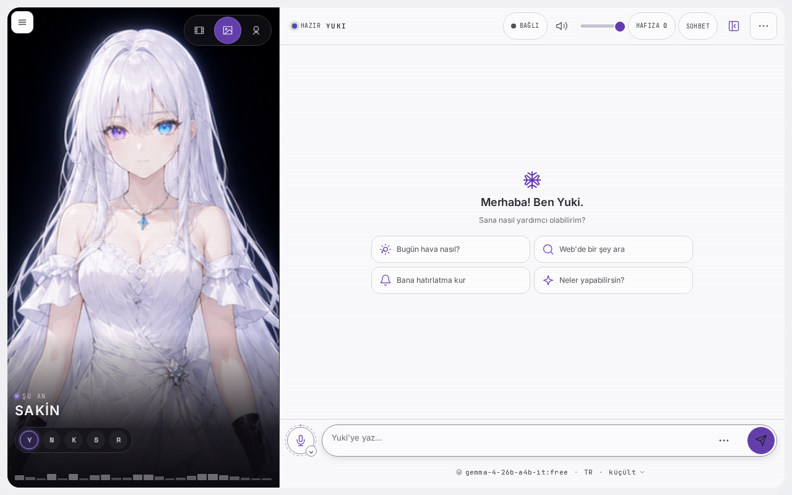
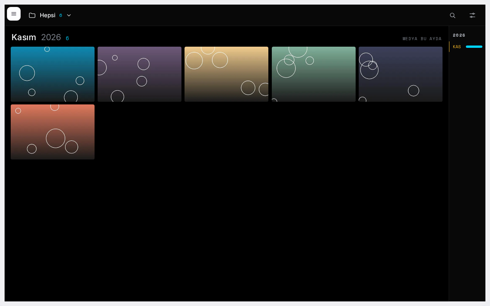
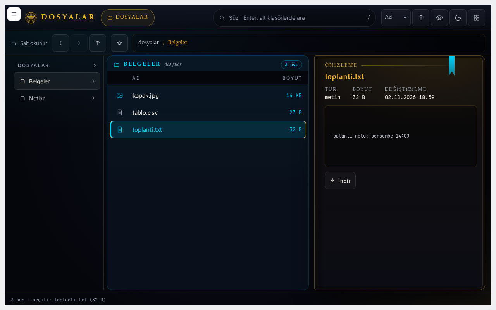
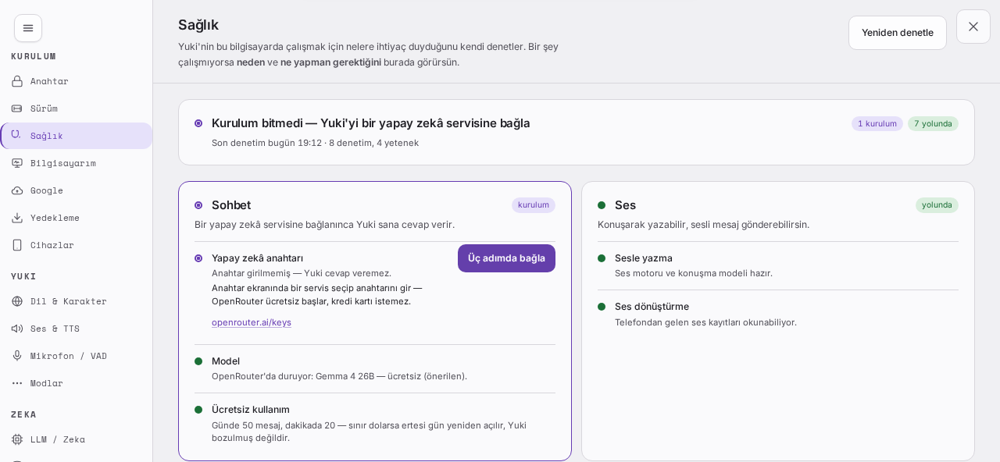
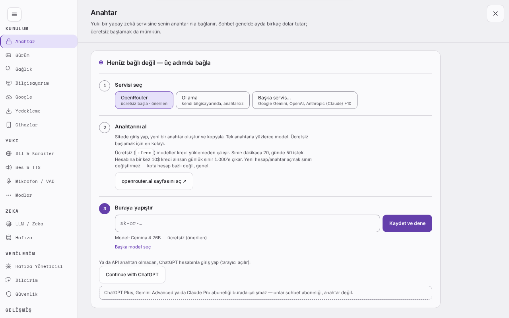
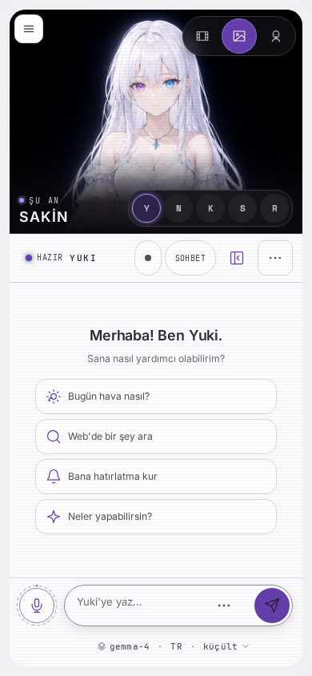
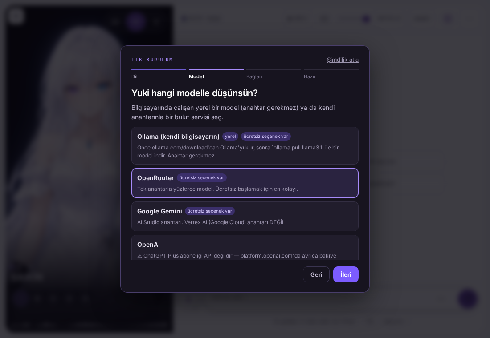
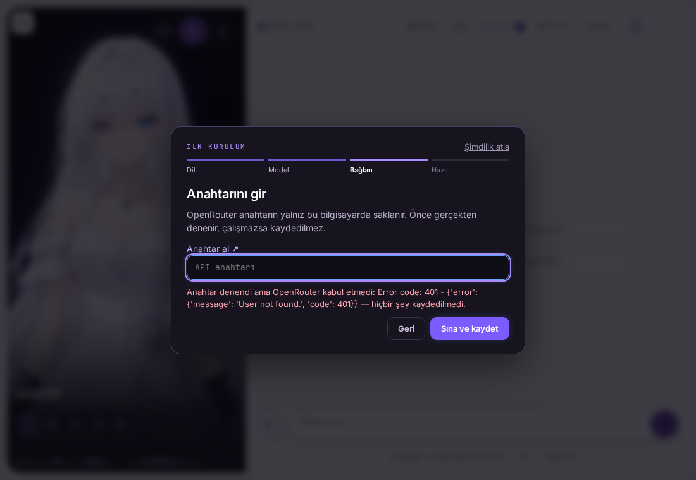

# Yuki — a voice AI companion for your desktop

Yuki is an open-source desktop AI companion that talks, listens, remembers and has a
character. It runs on **your own LLM key (BYOK)** — OpenRouter, OpenAI, Anthropic, Gemini,
Groq, a local Ollama and more. Your key is stored on your machine; your conversations go only to
the AI provider you pick — choose a local model and the text chat stays on your machine.
Spoken replies use Microsoft Edge TTS, so their text goes to Microsoft.

FastAPI backend · vanilla-JS frontend · Electron shell · Linux (Windows steps are tested in CI only).


> 🇹🇷 Türkçe özet aşağıda: [Türkçe](#türkçe).

## Features

- 🎙️ **Voice conversation** — local speech-to-text (`faster-whisper`), speech via
  Microsoft Edge TTS with cloud fallbacks (Google, ElevenLabs with your own key)
- 🧠 **Memory** — remembers facts about you; semantic search with a small ONNX model
  (optional), plain JSON storage when Postgres is not available
- 🎭 **Character and emotions** — the Yuki character, three view modes (classic, full body,
  HUD ring)
- 🔑 **BYOK, 15 providers** — keys are stored in your OS keyring
- 📋 **Planner, map board, device pairing (QR), Google/Drive backup**
- 🖼️ **Gallery and file browser — read-only by default.** Browse your photos and folders and
  send files to Yuki. Optional safe editing (move to trash, move, undo — no permanent delete,
  no rename) is off by default and needs the `AUTH_TOKEN` access key; there is no terminal. You choose which folders
  they show (see *Folders shown in Gallery and Files* below)
- 🩺 **Health check** — ⚙ Settings → Health tells you what is missing (key, voice, storage)
  and how to fix it
- 🔐 **App password + optional face login** — set `AUTH_TOKEN` in `.env` to require a
  password; the face model is downloaded only on demand (see licensing note below)
- 💬 **Sign in with ChatGPT** — use your ChatGPT account through OpenAI's official sign-in
  instead of an API key
- 🌐 **Turkish and English UI** — switch without restarting
- 🔄 **Update checker** — off by default; once releases exist it only asks GitHub whether
  a newer one is out (no data is sent)

**Deliberately not included:** running shell commands or arbitrary programs, remote
mouse/keyboard control, non-commercial local voice-cloning models and security tooling.

## Screenshots

All screenshots use demo data.

| Chat | Gallery (read-only) |
|---|---|
|  |  |
| **File browser (read-only)** | **Health check** |
|  |  |
| **Connect an AI service (BYOK or ChatGPT)** | **Phone-width layout** |
|  |  |

The Yuki character shown in the screenshots is not MIT-licensed — see [License](#license).

## Status

**Version 1.0.0** is the first open-source release (see [CHANGELOG](CHANGELOG.md)).
There are no prebuilt downloads yet — no AppImage or Windows installer. For now
Yuki is run from source (below), or you build the Linux AppImage or the Windows installer yourself. This README will
link to a release once one exists.

## Run from source

Requirements: **Python 3.12+** (CI uses 3.14), **Node.js LTS + npm** for the desktop shell
(Electron 44), Linux or Windows. Optional: **ripgrep** (`rg`) for the assistant's in-file search tool.

**Get the code** — with git, or download the ZIP from the repository page (**Code → Download ZIP**)
and unpack it:

```bash
git clone https://github.com/ihsandeniz/yuki-oss.git
cd yuki-oss
```

**`python3` or `python`?** On Linux and macOS the command is usually `python3`. On Windows,
the python.org installer gives you `python` (and the `py` launcher); typing `python3` may open
the Microsoft Store instead. The steps below use `python3` on Linux and `python` on Windows.

```bash
# 1) Backend on Linux (from the repository root)
cd backend
python3 -m venv venv
venv/bin/pip install -r requirements.txt
MEMORY_BACKEND=sqlite venv/bin/python -m uvicorn app.main:app --host 127.0.0.1 --port 8001
# → open http://127.0.0.1:8001/ui

# 2) Desktop shell (optional, in a second terminal, from the repository root).
#    The shell starts its own engine from backend/pybundle — build it once first:
bash scripts/pybundle-uret.sh
cd electron
npm ci
npm start
```

#### Windows steps (PowerShell)

Windows has its own pinned package list, `backend/pybundle-win-kilit.txt` (the same packages the
Windows build ships). These are the exact lines the CI Windows job runs with Python 3.14, from the
repository root:

```powershell
cd backend
python -m venv venv
venv\Scripts\python -m pip install -r pybundle-win-kilit.txt
$env:MEMORY_BACKEND = "sqlite"
venv\Scripts\python -m uvicorn app.main:app --host 127.0.0.1 --port 8001
# → open http://127.0.0.1:8001/ui
```

The desktop shell (step 2 above) is the same on Windows: `cd electron`, `npm ci`, `npm start`.

`MEMORY_BACKEND=sqlite` keeps memory in an embedded store (the same value as in
`.env.example`); without it Yuki expects Postgres and starts with memory off.
On Debian/Ubuntu, `python3 -m venv` needs the `python3-venv` package.

Check `python3 --version` first. If it is older than 3.12, `pip install` stops with
`No matching distribution found for numpy==2.5.1`; create the venv with a newer interpreter
instead, e.g. `python3.12 -m venv venv`. The install downloads about 1.3 GB of packages
(about a minute on a fast connection).

**What the first start does on the network:** before you add any key, the backend downloads
the speech-to-text model (`Systran/faster-whisper-small`, roughly 0.5 GB) from huggingface.co
and sends the word "Merhaba" to Microsoft Edge TTS (Google TTS if that fails) to warm up the
voice. Without internet both fail with a warning in the log and the rest of the app still starts;
chat answers *"OpenRouter key not set"* (HTTP 503) until you add a key.

Or use the helper script on Linux: `./start.sh` (backend + shell), `./start.sh --web`
(backend + browser), `./start.sh --no-ui` (backend only). Port: `YUKI_PORT` (default 8001).

### Check a clean install

`bash scripts/temiz-kurulum-sinavi.sh` repeats the steps above in an empty
`python:3.12-slim` container and exits 0 only if all of them pass: the backend installs from
`git archive HEAD` (no local files), `/health` answers 200, `/api/tts/test` returns speech from
Edge TTS, the asset-licence gate and `scripts/test_temizlik.py` report nothing. It uses
**podman** if installed, otherwise **docker** (`YUKI_KONTEYNER=docker` to choose). The container
runs with `--rm`; no volumes are created. Chat with an LLM is not part of the check.

### Build the Linux AppImage yourself

One command from a clean clone (needs bash, curl, python3, Node.js 20+; no Windows bundle):

```bash
bash scripts/linux-derle.sh
# → electron/dist/Yuki-<version>-lite.AppImage
```

It downloads a pinned, checksum-verified standalone CPython 3.14.3, installs the exact
package list in `backend/pybundle-kilit.txt` into `backend/pybundle/`
(`scripts/pybundle-uret.sh`), then packages with electron-builder.
The backend and its Python runtime are **inside** the AppImage: the user needs no Python,
pip or venv. The AppImage carries a static runtime, so it also starts on systems without
`libfuse2` (e.g. Debian 13, Kali); it still needs the kernel's FUSE device (`/dev/fuse`).

Check the result:

```bash
python3 scripts/test_appimage_paket.py --paket   # build settings + package contents (no secrets, no tests, static runtime)
bash scripts/appimage-kap-sinavi.sh              # run it in an empty Debian 13 container (no libfuse2, normal user,
                                                 # virtual screen): window opens, bundled backend answers /health,
                                                 # first-run wizard appears, 0 JavaScript errors; screenshots 1280 + 390 px
```

### Build the Windows installer yourself (on Linux)

The Windows installer is cross-built on Linux; no Windows machine is needed. One command
from a clean clone (needs bash, curl, python3, [uv](https://docs.astral.sh/uv/), Node.js 20+,
64-bit `wine`, `Xvfb`, `7z`, `perl`):

```bash
bash scripts/windows-derle.sh
# → electron/dist/Yuki-Setup-<version>.exe          (installer: per-user, no admin prompt)
# → electron/dist/Yuki-<version>-win-x64-lite.zip   (same app; the in-app full updater downloads this)
```

It downloads a pinned, checksum-verified Windows CPython 3.14.3 and unpacks the exact
package list in `backend/pybundle-win-kilit.txt` from Windows wheels into
`backend/pybundle-win/` (`scripts/pybundle-win-uret.sh`; a gate stops the build if any Linux
binary slips in), adds the MSVC C++ runtime DLLs so it runs without the VC++ Redistributable
(`scripts/vendor-msvc-runtime.py`), then packages with electron-builder. The backend and its
Python runtime are **inside** the installer: the user needs no Python.
Wine runs in its own throwaway prefix on a virtual screen; your `~/.wine` is not touched.

Check the result:

```bash
python3 scripts/test_windows_paket.py --paket   # build settings + package contents (no secrets, no tests, no Linux binaries)
bash scripts/windows-wine-sinavi.sh             # install silently into an empty wine prefix (no Python), start it:
                                                # window opens, bundled backend answers /health, first-run wizard,
                                                # 0 JavaScript errors; screenshots 1280 + 390 px
```

The installer is **not code-signed**, so Windows SmartScreen shows "Windows protected your PC"
on first run (More info → Run anyway). The wine test is not a real Windows: it does not cover
SmartScreen, Defender or a machine without the VC++ runtime.

**Yuki runs without the process supervisor ("bekçi").** It is an optional extra whose source
is not part of this repository; builds skip it by default and nothing in the app depends on it.
(Maintainers who have its source can add it with `YUKI_BEKCI_KAYNAK=<path>`.)

**Several copies at once:** each copy with its own data folder picks its own engine port
(8791 if free, otherwise any free port) and never connects to another copy's engine.
CI: the **Linux AppImage derlemesi** workflow (manual trigger) runs the same script.

**Data location:** when started by the desktop shell, Yuki keeps its data in the app's
user-data folder (Linux: `~/.config/yuki-oss`). When you run the backend directly, data is written next to the code
unless you set `YUKI_DATA_DIR=/some/folder`.

**Folders shown in Gallery and Files:** by default the Gallery shows your `~/Pictures`
(`~/Resimler`) folder and Files shows your home folder (hidden folders such as `.ssh` stay
hidden, and key/token files are refused even when hidden files are shown). To limit them, set
`YUKI_GALERI_KOKLER` / `YUKI_DOSYA_KOKLER` to one or more folders separated by `:` (`;` on
Windows), for example `YUKI_DOSYA_KOKLER=~/Documents:~/Downloads`.

### First-run setup

On a clean install a short setup wizard opens: language → model provider → key → ready
(screenshots show the Turkish interface).
A key is tested against the provider before it is saved; a wrong key is refused and nothing
is stored. You can skip the wizard and add a key later (below).

| Pick a provider | A wrong key is refused, nothing saved |
|---|---|
|  |  |

### Add your LLM key (BYOK)

1. Open **⚙ Settings → 🔑 Key**.
2. Pick a provider (OpenRouter has free models; Ollama needs no key at all).
3. Paste your key and save. No restart needed.

Keys are written to the OS keyring (Linux Secret Service / Windows Credential Locker).
Without a keyring they fall back to a `.env` file with mode 600. Never commit keys; see
`.env.example` for the variable names.

### Optional

- **Semantic memory model:** `scripts/ci-yerel.sh` shows how the ONNX embedding model is
  downloaded; point `EMBED_ONNX_DIR` at it. Without it memory still works with simpler
  matching.
- **Postgres + pgvector:** `docker compose up -d postgres` starts one on port 5437
  (`YUKI_PG_PORT`); set `DATABASE_URL` accordingly. Without it Yuki uses embedded
  JSON/SQLite stores.
- **Workshop (on by default):** Workshop (Atölye) runs background tasks in its own work folder
  (no shell, no writes outside it) and can suggest tasks it may do for you — it never starts one
  without your APPROVE. To switch it off, set `ATOLYE=false` in `.env` and restart. While off,
  its API returns 404 and the assistant does not see its tools.
- **Backup tab:** BACKUP copies the folders you pick to your Google Drive (connect Google in
  Settings first). Yuki never deletes files on your computer.
- **Fitness (off by default):** PLAN › FITNESS — workouts, meals, levels and weekly summary,
  stored only on this computer. Switch it on in *HQ › System › Fitness* (no restart) or with
  `FITNES=true`.
- **News clustering and filler sound:** MAP › NEWS shows one line per story with a `+N` sources
  badge (`GUNDEM_KUME=0` turns it off). An optional short "Hmm." when the reply is slow is off by
  default (*HQ › Voice & TTS*, or `DOLGU_SESI=1`).
- **Desktop Yuki (off by default):** needs your own `.vrm` model (`MASAUSTU_VRM`); none ships
  with Yuki. Its switch is in *HQ › System*.
- **Camera vision and voice identity (off by default, biometric):** `GORUS=true` lets Yuki look
  at one camera frame with a vision model **on this computer** (default Ollama `qwen2.5vl:3b`);
  `SES_KIMLIK=true` ignores voice commands from anyone but your enrolled voice. Each also needs
  a consent you give in *HQ › System*, only from this computer. Frames and recordings are not
  stored or sent. The voice model (3D-Speaker CAM++, Apache-2.0) is not shipped: download it
  from `https://huggingface.co/csukuangfj/speaker-embedding-models` and set `SES_KIMLIK_MODEL`.

### Advanced: MCP servers

Yuki can connect to [MCP](https://modelcontextprotocol.io) servers listed in
`backend/mcp_servers.json`. **All servers are disabled by default**, and there is no way to
enable or add one from the UI or from the AI — you have to edit the file by hand.

⚠️ Each entry's `command` is started as a program **on your machine, with your user's
permissions**. Only add servers you trust. Whatever a server you add runs or does is your
responsibility, not the project's.

### Note: Claude CLI provider

The "Claude CLI" provider calls the `claude` program installed on your computer
(`claude -p <prompt>`, no shell). Yuki only sends the conversation text and reads the text
reply; it does not grant the CLI any tools. The CLI's own behaviour and permissions are
governed by your local Claude Code settings.

**How to pick it (no API key needed):** skip the setup wizard's key step, then open the
**⋯ tools** menu next to the message box and tap **Claude**. Tap it again to go back to the
default free OpenRouter model. The badges and the Health panel treat it as keyless.

## Tests

```bash
# from the repository root
(cd backend && venv/bin/pip install -r requirements-dev.txt && venv/bin/python -m pytest -q)
(cd electron && npm test)
python3 scripts/test_temizlik.py     # repo hygiene gates (needs gitleaks on PATH)
python3 scripts/test_profil_adi.py   # app name / data folder gate
python3 scripts/test_appimage_paket.py --mutasyon   # AppImage gates catch what they should
python3 scripts/test_windows_paket.py --mutasyon    # Windows installer gates catch what they should
```

What the plain `pytest -q` above needs, or it reports red tests that are not bugs:

- **The ONNX embedding model** — without `EMBED_ONNX_DIR` about 25 memory tests fail on purpose
  with `GÖMME MODELİ YOK: <path>`. `scripts/ci-yerel.sh` downloads it (sha256-checked) and runs
  the same steps as CI in a clean copy; it uses `python3.14` (`CI_YEREL_PYTHON` to choose another).
- **A display** for the screenshot test — run under `xvfb-run -a` on a headless machine.
- **ripgrep** and the Playwright Chromium browser (`venv/bin/python -m playwright install chromium`);
  without the browser the Workshop browser tests are skipped locally.
- **gitleaks** for `test_temizlik.py`: the pinned version is in `.github/workflows/temizlik.yml`.

## Contributing

See [`CONTRIBUTING.md`](CONTRIBUTING.md) and [`CODE_OF_CONDUCT.md`](CODE_OF_CONDUCT.md).
Security issues: [`SECURITY.md`](SECURITY.md) — please report privately.

## License

- **Code:** MIT — see [`LICENSE`](LICENSE).
- **The Yuki character and all artwork are © ihsandeniz, all rights reserved.** Avatars,
  character images, sprites, animations, the 3D model and icons are **not** covered by the
  MIT License and may not be reused without written permission. Forks must replace them.
  Details and the file list: [`NOTICE`](NOTICE).
- **Third-party components:** [`THIRD_PARTY_LICENSES.md`](THIRD_PARTY_LICENSES.md).
  ⚠️ The optional face-login model (InsightFace `buffalo_l`) is licensed for
  **non-commercial use only**.

---

## Türkçe

Yuki, kendi LLM anahtarınla (BYOK) çalışan, sesli konuşan, hafızalı, karakterli açık
kaynak bir masaüstü AI arkadaşıdır. Anahtarın bilgisayarında saklanır; konuşmaların yalnız
seçtiğin yapay zekâ sağlayıcısına gider, yerel model seçersen yazışma bilgisayarında kalır.
Sesli cevaplar Microsoft Edge TTS ile üretilir; o metin Microsoft'a gider.

- **Durum:** sürüm **1.0.0**, ilk açık kaynak sürümü ([CHANGELOG](CHANGELOG.md)); hazır AppImage ya da
  Windows kurulumu henüz yok.
  Şimdilik kaynaktan çalıştırılır ya da Linux paketi / Windows kurulumu kendin derlenir
  (Windows kurulumu da Linux'ta derlenir: `bash scripts/windows-derle.sh`).
- **Kodu al:** `git clone https://github.com/ihsandeniz/yuki-oss.git` ya da depo sayfasında
  **Code → Download ZIP**.
- **Kaynaktan çalıştır:** yukarıdaki *Run from source* adımları
  (`backend/` içinde `python3 -m venv venv` → `venv/bin/pip install -r requirements.txt` →
  `MEMORY_BACKEND=sqlite venv/bin/python -m uvicorn app.main:app --port 8001` → `http://127.0.0.1:8001/ui`).
  Windows adımları (PowerShell) *Windows steps* başlığında: komut `python3` değil `python`, paket listesi
  `pybundle-win-kilit.txt`, başlatma `venv\Scripts\python -m uvicorn …`.
  Python en az 3.12 olmalı (`python3 --version`; eskiyse `python3.12 -m venv venv`). İlk açılışta
  ses tanıma modeli (~0,5 GB) huggingface.co'dan iner ve ses ısınması için Microsoft Edge TTS'e
  "Merhaba" gönderilir; anahtar girilene kadar sohbet "anahtar ayarlanmadı" der.
- **İlk sürümde:** sohbet ve ses, hafıza, galeri ve dosya gezgini (ikisi de varsayılan salt okunur; çöpe at /
  taşı / geri al isteğe bağlı, erişim anahtarıyla açılır, kalıcı silme yok; dosya gezgininden
  "Yuki'ye gönder"),
  harita, sağlık denetimi, giriş parolası, ChatGPT hesabıyla resmî giriş. Ekran görüntüleri
  yukarıda (*Screenshots*), demo veriyle.
- **Atölye (varsayılan açık):** Atölye arka plan görevlerini kendi çalışma klasöründe yürütür
  (kabuk yok, klasör dışına yazmaz); "yapayım mı?" önerisi verebilir ama sen ONAYLA demeden
  başlatmaz. Kapatmak için `.env`'e `ATOLYE=false` yazıp yeniden başlat; kapalıyken uçları 404
  döner.
- **YEDEK sekmesi:** seçtiğin klasörleri Google Drive'ına kopyalar (önce Ayarlar'dan Google'ı
  bağla). Yuki bilgisayarındaki dosyayı silmez.
- **Fitnes (varsayılan kapalı):** PLAN › FİTNES — antrenman, öğün, seviye ve haftalık özet;
  veri yalnız bu bilgisayarda. *HQ › Sistem › Fitnes* anahtarıyla açılır (yeniden başlatma
  gerekmez) ya da `FITNES=true`.
- **Gündem kümeleme ve dolgu sesi:** HARİTA › GÜNDEM aynı olayı tek satırda gösterir, yanında
  `+N` kaynak rozeti (`GUNDEM_KUME=0` kapatır). Cevap gecikince kısa "Hmm." isteğe bağlı,
  varsayılan kapalı (*HQ › Ses & TTS* ya da `DOLGU_SESI=1`).
- **Masaüstü Yuki (varsayılan kapalı):** kendi `.vrm` modelini ister (`MASAUSTU_VRM`); Yuki ile
  model gelmez. Anahtarı *HQ › Sistem*'de.
- **Kamera görüşü ve ses kimliği (varsayılan kapalı, biyometrik):** `GORUS=true` ile Yuki kameradan
  tek kareye **bu bilgisayardaki** görsel modelle bakar (varsayılan Ollama `qwen2.5vl:3b`);
  `SES_KIMLIK=true` kayıtlı sesin dışındaki sesli komutları yok sayar. İkisi de ayrıca
  *HQ › Sistem*'de, yalnız bu bilgisayardan verilen rıza ister. Görüntü ve ses kaydı saklanmaz,
  gönderilmez. Ses modeli (3D-Speaker CAM++, Apache-2.0) depoda yok: `SES_KIMLIK_MODEL` ile göster.
- **Galeri / Dosya hangi klasörü gösterir:** varsayılan `~/Resimler` ve ev klasörü;
  sınırlamak için `YUKI_GALERI_KOKLER` / `YUKI_DOSYA_KOKLER` (yolları `:` ile ayır).
- **Veri klasörü:** backend'i doğrudan çalıştırırken `YUKI_DATA_DIR=/bir/klasor`.
- **Linux paketi derle:** `bash scripts/linux-derle.sh` (tek komut). Süreç bekçisi olmadan çalışır; bekçi isteğe bağlıdır ve bu depoda değildir.
- **Birden çok kopya:** her kopya kendi veri klasörüyle kendi motor portunu seçer, başka kopyanın motoruna bağlanmaz.
- **Anahtar:** ⚙ Ayarlar → 🔑 Anahtar → sağlayıcı seç → anahtarı yapıştır → kaydet.
- **Lisans:** kod MIT. **Yuki karakteri ve görselleri tüm hakları saklıdır**, MIT kapsamında
  değildir (bkz. `NOTICE`). Yüzle giriş modeli (`buffalo_l`) yalnız ticari olmayan
  kullanım içindir.
